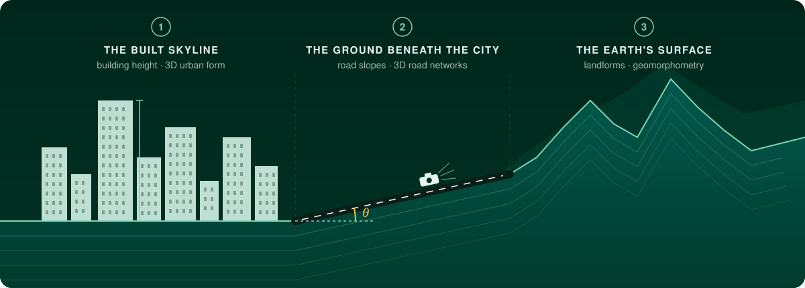

  

  
  
  
  
  
  

## 👋 Hi, I'm Yang

I'm a PhD candidate in **Cartography and GIS** at the School of Geography, **Nanjing Normal University**.

I was trained to read terrain, and I look at cities the same way: as surfaces with relief, structure and a history of how they were shaped. My research follows that third dimension from the skyline down to the landscape:

  

- 🏙️ **The built skyline:** building height, 3D urban form, the *vertical* 15-minute city
- 🛣️ **The ground beneath the city:** road slopes and 3D road networks from DEMs and street view imagery
- ⛰️ **The Earth's surface:** global landform classification, anthropogenic landforms, dunes, gullies and alluvial fans

## 🔭 Selected work

**[Vision2Slope: estimating urban road slopes with street view imagery](https://cubicsyang.github.io/publication/journal-article/2026-ijgis-yang/)** 
**Chen, Y.**, Fan, Z., Li, H., Zhao, W., Yang, X., Tang, G. (2026). *International Journal of Geographical Information Science*. 
[📄 Paper](https://doi.org/10.1080/13658816.2026.2656269) · [💻 Code](https://github.com/CubicsYang/Vision2Slope)

**[Vertical 15-minute city: Modeling urban density and functional mix with multi-source geospatial data](https://cubicsyang.github.io/publication/journal-article/2025-cities/)** 
**Chen, Y.**, Yang, X., Li, X., Yang, L., Cheng, S., Tang, G. (2025). *Cities*, 169, 106516. 
[📄 Paper](https://doi.org/10.1016/j.cities.2025.106516)

**[Refining urban morphology: An explainable machine learning method for estimating footprint-level building height](https://cubicsyang.github.io/publication/journal-article/2024-scs/)** 
**Chen, Y.**, Sun, W., Yang, L., Yang, X., Zhou, X., Li, X., et al. (2024). *Sustainable Cities and Society*, 112, 105635. 
[📄 Paper](https://doi.org/10.1016/j.scs.2024.105635) · [💻 Code](https://github.com/CubicsYang/Footprint_Building_Height_Estimation)

➡️ Full list on [my website](https://cubicsyang.github.io/) and [Google Scholar](https://scholar.google.com/citations?user=ObcghREAAAAJ).
